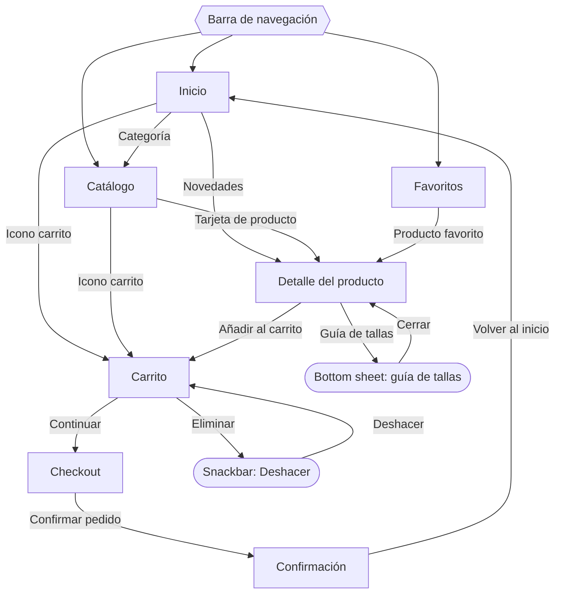

# Documentación de la interfaz — Chamaquitos

> App Android de ropa y calzado infantil (0–14 años) · Prototipo de alta fidelidad en Material Design 3
> Autor: Pedro Eduardo De La Puente Rodríguez · Repositorio: `diu-t1-ropainfantil`

---

## 1. Justificación del diseño

### 1.1 Importancia del diseño centrado en el usuario

Chamaquitos (nombre definitivo de la cadena «Pequeños Pasos» en este proyecto) vende ropa y calzado de 0 a 14 años. Quien compra casi nunca es quien usa la prenda: son madres, padres, abuelos o personas que regalan, y suelen hacerlo desde el móvil, con una mano y con prisa. Si la interfaz se diseña pensando en el catálogo y no en esa persona, los problemas aparecen justo donde duele: no se sabe qué talla pedir, la compra se alarga y el carrito se abandona.

Diseñar partiendo del usuario obliga a decidir con evidencias y no con gustos. En este proyecto eso significa investigar a quién se compra y cómo (personas, competencia, insights), pasar de baja a alta fidelidad con decisiones justificadas y validar con gente real antes de dar nada por bueno. Material Design 3 aporta una base probada en Android (componentes, accesibilidad, rejilla y roles de color), de modo que el esfuerzo se concentra en resolver los problemas propios del dominio: tallas, tiempo y confianza.

### 1.2 Objetivos y metas del proyecto

| # | Objetivo | Métrica | Meta |
|---|----------|---------|------|
| O1 | Compra rápida | Tiempo desde Inicio hasta Confirmación con un producto concreto | ≤ 2 minutos |
| O2 | Reducir dudas con la talla | Usuarios que consultan la guía de tallas sin ayuda y eligen una talla | ≥ 80 % de los participantes |
| O3 | Facilidad de uso con una mano | Tareas completadas sin errores graves en las pruebas | ≥ 90 % de éxito |
| O4 | Accesibilidad visual | Parejas color / on-color con contraste ≥ 4,5:1 (WCAG AA) | 100 % de las parejas |

### 1.3 Beneficios esperados

**Para el usuario**
- Comprar en pocos pasos y con la talla correcta, sin tener que ir a la tienda física.
- Menos errores y devoluciones gracias a la guía de tallas integrada en el detalle del producto.
- Una interfaz legible y cómoda con una mano, con áreas táctiles amplias y buen contraste.

**Para el negocio**
- Mayor conversión al acortar el embudo (Inicio → Catálogo → Detalle → Carrito → Checkout → Confirmación).
- Menos devoluciones por talla equivocada, lo que reduce costes logísticos.
- Un canal propio (la app) que refuerza la relación con las familias frente a las tiendas físicas.

---

## 2. Investigación y análisis de usuarios

### 2.1 Datos demográficos y segmentación

Los datos siguientes son una estimación de trabajo basada en el enunciado y en el perfil habitual del sector; no proceden de una encuesta propia.

| Segmento | Perfil | Frecuencia de compra | Necesidad principal |
|----------|--------|----------------------|---------------------|
| Madres y padres (28–45 años) | Compra de reposición y por temporada, varios hijos | Alta (mensual o más) | Rapidez y acertar con la talla |
| Abuelos y abuelas (55–75 años) | Compra de regalos, menor soltura digital | Baja (ocasiones puntuales) | Claridad, textos legibles, pocos pasos |
| Personas que regalan (25–50 años) | Cumpleaños, bautizos, nacimientos | Esporádica | Orientación por edad sin conocer la talla |

Contexto de uso común: smartphone Android, una mano, desplazamientos o ratos libres, sesiones cortas e interrumpidas.

### 2.2 Personas

#### Persona 1: Laura Martínez, la madre que compra a menudo

- **Edad:** 36 años. **Ocupación:** administrativa. **Familia:** dos hijos (2 y 7 años).
- **Contexto:** compra desde el móvil en el autobús o mientras prepara la cena. Sus hijos crecen rápido y renueva ropa cada temporada.
- **Objetivos:** comprar en pocos minutos, repetir tallas anteriores, guardar favoritos para volver luego.
- **Frustraciones:** las tallas cambian de una marca a otra; formularios largos; tener que ampliar fotos para ver el producto; perder el carrito si se cierra la app.

#### Persona 2: Antonio Ruiz, el abuelo que busca un regalo

- **Edad:** 68 años. **Ocupación:** jubilado. **Familia:** tres nietos (1, 5 y 9 años).
- **Contexto:** usa el móvil para llamadas y mensajería; compra online pocas veces. Quiere regalar algo para un cumpleaños sin conocer la talla exacta.
- **Objetivos:** encontrar un regalo adecuado a la edad del niño, entender qué talla pedir, terminar la compra sin equivocarse.
- **Frustraciones:** letra pequeña, botones poco claros, términos técnicos, miedo a pulsar algo y no poder deshacerlo.

### 2.3 Análisis de la competencia

Análisis cualitativo a partir de la experiencia de uso general de cada app; conviene contrastarlo con una revisión actualizada antes de la entrega final.

| App | Qué hace bien | Qué hace mal | Qué me llevo |
|-----|---------------|--------------|--------------|
| **H&M** | Catálogo amplio, filtros claros, favoritos | Cuadrícula muy densa; guía de tallas genérica | Filtros visibles y favoritos accesibles desde la barra inferior |
| **Zara** | Estética muy cuidada, fotografía grande | Navegación menos intuitiva; menú profundo | Fotografía protagonista en el detalle, pero con navegación más simple |
| **Vertbaudet** | Especializada en infantil, categorías por edad | Interfaz cargada y proceso de compra largo | Categorías por edad en la pantalla de inicio |
| **Primark** | Catálogo visual sencillo | Orientada a consulta más que a compra | Mantener una interfaz limpia sin saturar de información |

### 2.4 Insights y hallazgos clave

| # | Insight | Decisión de diseño |
|---|---------|--------------------|
| I1 | Las familias dudan con las tallas porque varían entre marcas y cambian con la edad. | Selector de talla propio en el detalle y botón «Guía de tallas» que abre un bottom sheet con talla, edad y altura. |
| I2 | Quien regala suele pensar en la edad del niño, no en la talla. | Categorías por edad (Bebé 0-24 m, Niña, Niño) en Inicio y talla expresada en años. |
| I3 | Se compra con una mano y poco tiempo. | Acciones principales en la parte inferior, navigation bar con tres destinos y botones grandes (≥ 48 dp). |
| I4 | El miedo a equivocarse frena la compra, sobre todo en usuarios mayores. | Snackbar «Deshacer» al eliminar del carrito y mensajes de ayuda claros en el checkout. |
| I5 | Los formularios largos provocan abandono. | Checkout con solo cuatro campos (nombre, dirección, teléfono, email) y validación inmediata. |

---

## 3. Diseño de la interfaz

### 3.1 Mapa de navegación

La navigation bar inferior tiene tres destinos: **Inicio**, **Catálogo** y **Favoritos**. El carrito se alcanza desde el detalle del producto al añadir un artículo.

### 3.2 Wireframes

Wireframes de baja fidelidad en escala de grises, realizados en Figma (página «Wireframes»). Se han dibujado los 7 destinos obligatorios más 2 estados adicionales: la guía de tallas como bottom sheet y el carrito con el snackbar «Deshacer».

| # | Pantalla | Qué contiene |
|---|----------|--------------|
| 1 | Inicio | Top app bar «Chamaquitos», categorías (Bebé, Niño, Niña), novedades en tarjetas, banner de temporada y navigation bar. |
| 2 | Catálogo | Chips de filtro (Talla, Color, Precio) y cuadrícula de productos con nombre y precio. |
| 3 | Detalle de producto | Zona de foto con indicador de carrusel, nombre y precio, selector de talla (6, 8, 10, 12 años), botón «Guía de tallas» y «Añadir al carrito». |
| 4 | Carrito | Artículos con botones de cantidad y eliminar, resumen (subtotal, envío, total) y botón «Continuar». |
| 5 | Checkout | Campos Nombre, Dirección, Teléfono y Email, total a pagar y botón «Confirmar pedido». |
| 6 | Confirmación | Icono de éxito, «Pedido realizado», número de pedido (PP-0001), mensaje de email y «Volver al inicio». |
| 7 | Favoritos | Productos guardados en cuadrícula y tarjeta con la palabra del día en el pie. |
| 8 | Guía de tallas (estado de 3) | Bottom sheet con tabla Talla / Edad / Altura. |
| 9 | Snackbar (estado de 4) | Mensaje «Eliminando…» con acción «Deshacer». |

(<Captura de pantalla 2026-10-12 202011.png>)

Archivos individuales previstos en `capturas/wireframes/`:
`01-inicio.png`, `02-catalogo.png`, `03-detalle.png`, `04-carrito.png`, `05-checkout.png`, `06-confirmacion.png`, `07-favoritos.png`, `08-guia-tallas.png`, `09-carrito-snackbar.png`.

**Decisiones de estructura**
- Las acciones principales (Añadir al carrito, Continuar, Confirmar pedido, Volver al inicio) ocupan el ancho completo en la zona inferior, accesible con el pulgar.
- Los wireframes se han hecho en frames Android Compact de 360×800 dp. En el archivo de Figma conviene renombrar los frames de «Android Large» a «Android Compact» para ser coherentes con la entrega.

### 3.3 Guía de estilo Material Design 3

Esquema de color generado con **Material Theme Builder** a partir del color semilla **`#576BCC`** (azul-índigo, transmite confianza y es neutro respecto al género). Los tokens completos están en [`diseno/estilos.json`](diseno/estilos.json).

#### Colores base (core colors)

| Rol | Color |
|-----|-------|
| Primary | `#576BCC` |
| Secondary | `#788AEB` |
| Tertiary | `#6996B1` |
| Neutral | `#778FCF` |
| Neutral variant | `#7595AC` |

#### Esquema claro

| Rol | Hex | On-color | Hex |
|-----|-----|----------|-----|
| primary | `#505B92` | onPrimary | `#FFFFFF` |
| primaryContainer | `#DEE1FF` | onPrimaryContainer | `#384379` |
| secondary | `#515B92` | onSecondary | `#FFFFFF` |
| tertiary | `#1D6586` | onTertiary | `#FFFFFF` |
| surface | `#FAF8FF` | onSurface | `#1A1B21` |
| error | `#BA1A1A` | onError | `#FFFFFF` |

#### Esquema oscuro

| Rol | Hex | On-color | Hex |
|-----|-----|----------|-----|
| primary | `#B9C3FF` | onPrimary | `#212C61` |
| primaryContainer | `#384379` | onPrimaryContainer | `#DEE1FF` |
| secondary | `#BAC3FF` | onSecondary | `#222C61` |
| tertiary | `#90CEF4` | onTertiary | `#00344A` |
| surface | `#121318` | onSurface | `#E2E2E9` |
| error | `#FFB4AB` | onError | `#690005` |

#### Contraste (WCAG AA, mínimo 4,5:1)

Ratios calculados con la fórmula de luminancia relativa de WCAG 2.1.

| Pareja | Claro | Oscuro | ¿Cumple AA? |
|--------|-------|--------|-------------|
| primary / onPrimary | 6,46:1 | 7,71:1 | ✅ |
| primaryContainer / onPrimaryContainer | 7,26:1 | 7,26:1 | ✅ |
| secondary / onSecondary | 6,44:1 | 7,71:1 | ✅ |
| secondaryContainer / onSecondaryContainer | 7,24:1 | 7,24:1 | ✅ |
| tertiary / onTertiary | 6,45:1 | 7,75:1 | ✅ |
| tertiaryContainer / onTertiaryContainer | 7,25:1 | 7,25:1 | ✅ |
| error / onError | 6,46:1 | 7,72:1 | ✅ |
| errorContainer / onErrorContainer | 7,24:1 | 7,24:1 | ✅ |
| surface / onSurface | 16,31:1 | 14,39:1 | ✅ |
| surfaceVariant / onSurfaceVariant | 7,19:1 | 5,46:1 | ✅ |

Todas las parejas superan el mínimo de 4,5:1 en ambos esquemas. El archivo de tokens incluye además variantes de contraste medio y alto (claro y oscuro) por si se quisiera ofrecer un modo de accesibilidad reforzada.

#### Tipografía

Familia **Roboto**, escala tipográfica de Material Design 3:

| Rol | Tamaño (sp) | Interlineado | Peso | Uso en la app |
|-----|-------------|--------------|------|---------------|
| headlineSmall | 24 | 32 | 400 | Títulos de sección (Categorías, Novedades) |
| titleLarge | 22 | 28 | 400 | Título de pantalla en la top app bar |
| titleMedium | 16 | 24 | 500 | Nombre y precio del producto |
| bodyLarge | 16 | 24 | 400 | Texto general y campos de formulario |
| labelLarge | 14 | 20 | 500 | Botones y chips |

#### Rejilla y espaciado

- **Rejilla:** 4 columnas (Android Compact).
- **Márgenes de pantalla:** 16 dp.
- **Unidad base:** 8 dp; todo el espaciado es múltiplo de 8 (4 dp solo para ajustes finos de iconos).
- **Áreas táctiles:** mínimo 48×48 dp en botones, chips, selector de talla e iconos de la barra.

#### Componentes M3 utilizados

Top app bar, Navigation bar, Card, Filter chip, Button, Text field, Snackbar y Bottom sheet.

#### Componentes propios

| Componente | Variantes | Uso |
|-----------|-----------|-----|
| **TarjetaProducto** | normal, favorito, agotado | Catálogo, Novedades y Favoritos |
| **SelectorTalla** | disponible, seleccionada, sin stock | Detalle de producto (6, 8, 10, 12 años) |

Ambos se construyen con auto layout en Figma y variantes controladas por propiedades.

### 3.4 Prototipo de alta fidelidad

- **Archivo Figma:** `<enlace al archivo de Figma>`
- **Prototipo navegable:** `<enlace al prototipo>`
- **Capturas:** carpeta `capturas/prototipo/` (PNG 360×800).

**Flujo de compra conectado:** Inicio → Catálogo → Detalle → elegir talla → Carrito → Checkout → Confirmación. La navigation bar funciona entre Inicio, Catálogo y Favoritos.

**Elementos requeridos incluidos**
- Guía de tallas como overlay (bottom sheet) desde el detalle.
- Al menos una transición **Smart Animate** (por ejemplo, selección de talla o apertura del bottom sheet).
- Estado de error en el formulario del checkout (campo con borde `error` y mensaje de ayuda).
- Versión en **modo oscuro** de Inicio y Detalle con el esquema oscuro.
- Palabra del día en el pie de Favoritos (ver final del documento).

## 4. Validación y pruebas

### 4.1 Metodología

Pruebas de usabilidad moderadas con **al menos dos compañeros de otro grupo de trabajo**, usando el prototipo de Figma en un móvil o en el modo presentación. A cada participante se le pide pensar en voz alta y no se le ayuda salvo bloqueo total.

| Tarea | Enunciado | Éxito si… |
|-------|-----------|-----------|
| T1 | «Compra una camiseta de talla 8 años y llega hasta la confirmación del pedido.» | Llega a la pantalla de confirmación |
| T2 | «Averigua qué talla corresponde a un niño de 104 cm de altura.» | Abre la guía de tallas y responde la talla correcta |
| T3 | «Elimina un artículo del carrito y recupéralo.» | Usa «Deshacer» y el artículo reaparece |

**Métricas:** éxito (sí / no), tiempo por tarea (segundos) y errores (pulsaciones equivocadas o dudas claras).

### 4.2 Resultados

### 4.3 Iteraciones y mejoras

## 5. Entrega y documentación final

### 5.1 Justificación del diseño propuesto

La propuesta de Chamaquitos responde a los problemas detectados en la investigación: la duda con las tallas se aborda con un selector propio y una guía de tallas accesible en un toque; el poco tiempo disponible, con un flujo de compra corto y botones principales en la zona del pulgar; el miedo a equivocarse, con acciones reversibles (snackbar «Deshacer») y mensajes de ayuda en el formulario.

La elección de Material Design 3 garantiza consistencia con el sistema Android, un esquema de color con contraste verificado (todas las parejas ≥ 4,5:1), una escala tipográfica legible y una rejilla de 4 columnas con áreas táctiles de al menos 48 dp. Los componentes propios (TarjetaProducto y SelectorTalla) concentran el comportamiento específico del dominio y son reutilizables.

### 5.2 Recomendaciones y pasos a seguir

1. Repetir las pruebas con perfiles más cercanos al público real (abuelos, madres y padres) y con más participantes.
2. Añadir buscador con sugerencias y filtro por talla recordada del niño.
3. Permitir perfiles infantiles guardados (edad y talla) para acelerar compras repetidas.
4. Completar estados vacíos y de carga (carrito vacío, sin conexión, producto agotado).
5. Evaluar un diseño adaptable para pantallas medianas (tablets y plegables).
6. Traspasar los tokens de `estilos.json` a un tema de Jetpack Compose para la fase de desarrollo.

## 6. Referencias bibliográficas

Google. (s. f.). *Material Design 3*. https://m3.material.io/

**Palabra del día:** 29